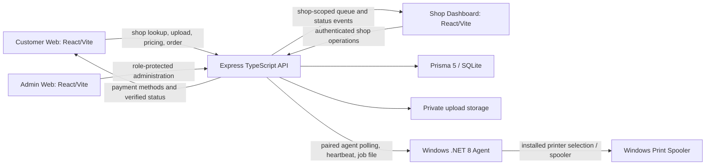

# PrintQ reference reconnaissance and implementation audit

**Scope:** read-only reconnaissance of the public reference and the PrintQ source, followed by limited, evidence-based reliability and content changes. No production data, configuration, or services were changed.

## Reference pages discovered

The reference was inspected at the following URLs on 2026-10-30. These are observations of the pages available to the browser/text inspection, not verification of the reference vendor's operational claims.

| URL | Observed content | Status |
| --- | --- | --- |
| `https://qrseprint.in/` | Main landing page, navigation, product choice, setup video, plans, WhatsApp printing, Android product, cyber-cafe tools, reviews, feature/operations sections, privacy claims and footer | Inspected |
| `/features` | Same landing-page shell/content as home, with Feature navigation | Inspected; not a distinct feature detail page |
| `/about` | Same landing-page shell/content as home | Inspected; not a distinct about page |
| `/contact` | Same landing-page shell/content plus contact navigation/content | Inspected |
| `/partner` | Same landing-page shell/content with Partner Program entry | Inspected; distinct agent details are at `/agent` |
| `/disclaimer` | Same landing-page shell/content with Declaration navigation | Inspected |
| `/requirements` | Separate WhatsApp-print product page and demo/plan form | Inspected; form submission was not performed |
| `/agent` | Separate referral/agent program page | Inspected; no account or payout action performed |
| `/whitelabel` | Separate white-label partner page/form | Inspected; form submission was not performed |
| `/international` | Country selection and localized pricing/registration content for named countries | Inspected; no transaction performed |
| `/android` | Redirects to the main landing page | Inspected |

The reference's page shell advertises several separate products (WhatsApp printing, Android printing, offline cyber-cafe software, international plans, referral agents and white-label reselling). They are not assumed to be PrintQ features. The reference also makes claims about deletion, installed printers, payment routing, counts and uptime which were not independently verified and are not copied as factual PrintQ claims.

### Navigation, layout and observed journey

The public shell has desktop navigation for Home, Pricing, How to Setup, Feature, About, Contact, Partner Program, Declaration and Shop Owner Login, plus a mobile navigation variant and promotional banners. The landing page order observed is product/hero, product/device choice, setup video, plans, WhatsApp product, Android product, cyber-cafe product, reviews, broader feature list, privacy/operations content, FAQs and footer. The `/requirements` flow collects shop/contact/plan details and explains WhatsApp pairing and print setup. The accessible content exposes no authenticated shop dashboard or customer transaction; those parts were not exercised.

**Visual evidence and scope:** reference homepage captures were reviewed at 390×844, 768×1024 and 1440×900. Local Customer Web, Shop Dashboard login and Admin login captures were reviewed at 390×844 and 1440×900. The reference is a public marketing/product site; it does not expose an equivalent authenticated shop or super-admin console. Those PrintQ consoles therefore remain purpose-built operational applications, and are not represented as pixel replicas of unrelated reference pages. Screenshot captures were reviewed inline and are not committed as production assets. Exact pixel equality has not been measured.

## PrintQ architecture and workflow map

The repository is an npm-workspaces monorepo (`apps/*`, `packages/*`) with shared `@printqr/config`, `@printqr/types` and `@printqr/validation`. The API has Express routes under `/api`, Prisma/SQLite persistence, uploaded-file storage and Socket.IO. React/Vite applications live at `apps/customer-web`, `apps/shop-dashboard` and `apps/admin-web`. The Windows agent is a .NET 8 WPF application under `apps/print-agent`.

### Main source entry points

| Area | Source evidence |
| --- | --- |
| Customer routes | `apps/customer-web/src/App.tsx`: `/print/:shopSlug`, `/track/:orderNumber`, shop registration and legal routes; tracking token remains in query string |
| QR customer journey | `apps/customer-web/src/pages/CustomerLandingPage.tsx`: shop options, upload/settings, server pricing and idempotent `POST /orders/create` |
| Order tracking/payment | `apps/customer-web/src/pages/OrderTrackingPage.tsx`: token-protected tracking, pending UPI reference and payment-status polling |
| Customer endpoint client | `apps/customer-web/src/lib/api.ts`; API URL selection in `apps/customer-web/src/lib/api-base-url.js` |
| Order API | `apps/api/src/routes/order.routes.ts`: `POST /create`, `GET /track/:orderNumber`, authenticated shop order and job operations |
| Payment API | `apps/api/src/routes/payment.routes.ts`: payment creation/status, manual UPI proof, gateway webhooks and shop gateway settings |
| Shop lookup | `apps/api/src/routes/shop.routes.ts`: public slug lookup and shop-scoped operations |
| College free-print | `apps/api/src/routes/free-print.routes.ts`: public options, user/guest verification, admin and shop operations |
| Agent API | `apps/api/src/routes/agent.routes.ts`: pairing, polling, file download, printer sync, heartbeat and job status |
| Persistence | `apps/api/prisma/schema.prisma`: shops, printers, agents, orders, items, jobs, payments and subscriptions |
| Admin / shop portals | `apps/admin-web` and `apps/shop-dashboard`; both call shared API routes, protected by backend authentication/authorization |
| Windows desktop | `apps/print-agent`; .NET 8 WPF, local printer integration and paired API communications |

### Journey status

| Journey step | Source-level status | Limits / evidence |
| --- | --- | --- |
| Open shop QR route | Implemented | Customer route uses slug and public shop lookup; live shop availability was not tested here |
| Upload documents and set options | Implemented | Existing upload/validation/settings flow is present; real file service not exercised in this audit |
| Get price | Implemented | Server calculation endpoint is used; marketing page no longer substitutes local plan defaults |
| Create order and get tracking values | Implemented | API creates order/jobs transactionally and uses request idempotency; payment initialization happens after the order transaction, so a later initialization error can leave a persisted order for retry/recovery |
| Pay / submit UPI reference | Partially implemented | UPI is direct shop payment and manual verification; customer-submitted references are not proof of payment |
| Shop queue and payment review | Implemented | Shop-authenticated endpoints and payment review paths exist; production account-level flow not replayed |
| Agent pairing and polling | Implemented | Temporary pairing, paired-agent auth, shop-scoped polling/file access and status reports exist |
| Print output | Partially implemented | Windows agent talks to the Windows spooler; source/API status does not establish physical paper output or device feedback |
| Lost agent job recovery | Fixed in this branch | Expired in-flight claim now enters `FAILED`/operator review; never silently requeued because a duplicate physical print cannot be ruled out |
| Receipts/history | Implemented in source | Not independently exercised against production data |

## Feature comparison and page status

| Reference experience | PrintQ counterpart | Status and action |
| --- | --- | --- |
| Main hero and navigation | Customer Web `HomePage` | Kept PrintQ/AnishNova identity; removed simulated operational values and corrected timing/printing claims |
| Plans and pricing | Public plan API + `HomePage` pricing | Now renders only valid active API plans; no hardcoded plan fallback. Empty/error state is explicit with retry |
| Setup video | Public demo-video API | No sample video fallback; section is hidden until active API configuration arrives |
| Testimonials and statistics | Public APIs | Testimonials only appear when returned by API; statistics show unavailable markers instead of invented values |
| Contact and partner forms | Existing lead APIs in `HomePage` | Success only follows an API success response; network/API errors are shown, not replaced with fabricated reference numbers |
| Windows agent download | Agent release metadata endpoint | Version comes from validated API manifest; failed/invalid metadata shows unavailable with retry, no `1.0.0` fallback |
| Customer header navigation | Customer Web `HomePage` | This stage removes duplicate Contact/Partner actions when those destinations already exist in API-configured navigation, keeps them available when omitted, tightens desktop spacing and corrects the repeated “from” in the hero headline |
| Shop and Admin mobile navigation | Operational portal shells | Added dismissible scrims, Escape-to-close, accessible menu labels/state and explicit sidebar labels; operational content and permissions are unchanged |
| WhatsApp print product | No verified equivalent identified in PrintQ source | Not copied or represented as implemented |
| Android print app | No verified Android app in this monorepo | Not copied or represented as implemented |
| Offline cyber-cafe suite | No verified equivalent in this monorepo | Not copied or represented as implemented |
| International localized plans | Existing schema/API not shown to implement the reference country flow | Not copied; needs an explicit product and pricing decision |
| Referral / white-label pages | PrintQ has partner-related code but not verified parity with reference mechanics | Existing PrintQ partner flow retained; no external payout or white-label capability invented |
| Feature detail / about / declaration | PrintQ's landing sections and legal routes | No pixel-level page parity verified; separate reference URLs mostly return the same shell, while reference product claims are not adopted without source evidence |

Screenshots confirm the broad responsive hierarchy, but exact geometry, font rendering, color values, icon shapes and image positioning have not been measured against the reference. The Customer Web is the closest visual counterpart; the Shop and Admin portals have no matching authenticated reference screens. This code stage addresses confirmed responsive hierarchy differences; it does not claim pixel-perfect replication.

### Screenshot comparison — 2026-10-30

Fresh controlled Chromium captures were taken with the same viewport, device scale factor 1, locale, timezone and reduced-motion settings. REA evidence IDs and screenshot SHA-256 values are recorded below so the before/after captures can be identified without checking image binaries into the repository. The captures are rendered inline in the task history; authenticated portal content was not captured because no test credentials were supplied.

| Viewport | Reference before / after (evidence ID) | PrintQ Customer before (evidence ID, SHA-256) | PrintQ Customer after (evidence ID, SHA-256) |
| --- | --- | --- | --- |
| 1440×900 | `ev_741c8829ff9c5a0744ecda72d668def25608c8901213bd915bd4bab2ab039460` / `ev_0b7f4e8c401c706e0b3d35ae76e71f19f8000b2fb0b60763e1686b5bc2bbce3f` | `ev_7eae66a3f6a1bdb9df97cca7a200d45452ff76b605d319f33566aaccea09d300`, `7f4047bc18a46fafbd58d7996c25a00eeeee21e23baa52c83656baff2ccea533` | `ev_628ffd7691daa00dca34c9b529ab45bf5a145e16e6b8cf34cd6d9b89e96edfec`, `af5e46e7461ed588bb4e95ed55f67b3c2386db55cfe5a5aac3162404974a1563` |
| 768×1024 | `ev_4631dc27a0e15e4307918345daf958de38c4b4be8e15b30d1f5f0dce08b6ae76` / `ev_297df3285fabba8b35c616c8b92f5396a69684573bc1fb1a465ff9fdbf0c8cb2` | `ev_4427833a58bacd6cc16ebeba06efb78283eae869741e68fa4966347ea17af90e`, `df7aadf69f266b0477dac0bcbd4fc88bc07896567e4c93cf2bd1bef2da366708` | `ev_66e03e05b6fb516f71895f77ea0f9a706472ad6a50240fe169b716d4aa3882a7`, `1a817cab748d00855c94f982e08c3b7277ae314592e3ed1beb1b7ec477b49a8f` |
| 390×844 | `ev_97c0b42578ce6ef75a4eab8acd3a1975b6a955d1d95bd40d2a67426ffc89869a` / `ev_6ca5269edc06631d17326ef624c75f29686f2095cea3bac49644e44d689e9284` | `ev_1759545141b8205ceec5e642199591d203292658081c879ffe8390ef70a8a0d4`, `28628d62440158dd304156a418cb6b9db2e9baeb5fc736267ab8be5e81667204` | `ev_a109821820dbf6719d419ae48a98692ff41024453d62bb651b65bb99b930787f`, `43f2261e746b899885152966c07a245cdb0578a28c4aaf23bb1d1f3a5b8f6bdc` |

#### Confirmed visual differences and changes

- **Header/navigation:** At 768px and 390px the reference keeps a Shop Owner Login control beside its menu. Before this pass PrintQ hid the login link inside the drawer. The Customer Web now shows a lock icon link at 390px and icon plus “Shop Owner Login” at 768px, retaining the existing `SHOP_PORTAL_URL/login` destination. The 1440px desktop navigation remains unchanged. The reference QRSePrint logo, dotted ornament and its exact header treatment are intentionally not copied over AnishNova Print branding.
- **Hero hierarchy:** The reference uses a QR/printer illustration, a short two-part headline and a scan/upload/pay/print icon row. PrintQ previously had a three-line headline, four bordered feature cards and a workflow preview panel. The headline now reads “From Your Phone / Print Straight to Your Shop”; at phone width the workflow steps are compact, centered icons and the two actions share one row. This reduces the vertical stack and moves the existing illustrative workflow preview higher on mobile. Desktop and tablet keep the existing evidence-based PrintQ workflow panel.
- **Cards, colors and spacing:** Both pages use a warm light background and dotted texture. The reference uses pink/purple accents, a dark privacy banner and bespoke artwork; PrintQ retains its purple/pink/orange brand, small operational copy, four workflow cards and five-column feature strip. The reference’s “files deleted immediately” claim was not adopted because it is not established by the PrintQ retention configuration.
- **Buttons:** The mobile customer actions were previously stacked and occupied two full rows. They now display side by side at 390px, matching the reference’s compact horizontal action grouping. Both remain the existing real pricing anchor and shop-registration action.
- **Responsive result:** The final 390px capture shows no horizontal overflow, the login shortcut, four compact step tiles and side-by-side calls to action. At 768px the login label sits next to the hamburger and the desktop/tablet centered hero remains balanced. At 1440px the prior two-column layout remains intact. No screenshot establishes exact pixel equality or reproduces the reference’s custom QR/printer art.

#### Portal screenshot scope

The Shop Dashboard and Admin Web do not have corresponding authenticated reference pages. Their login routes were captured at 1440×900, 768×1024 and 390×844 to check responsive shape only:

- Shop login: `ev_f5b295fc94591c5681ae89e21682820e6ebe36dcb29e3093ca9346051f388bc4` (1440), `ev_00d3878f18ce7cd74dd41303d5d23b0b9c9a7036cd1f887be247c52255b65804` (768), `ev_feb96100a3a923c0b4aec5367a5c8907041550f20365fbb851ea19775c181202` (390).
- Admin login: `ev_fdcb86effc7dca6746a01ae560c6d65f123b922749f2cae94e7191aece50a8ff` (1440), `ev_56428392f65238f5c0a719b80b6ec7be0917ebcf4babf5a53ad7631e3dbe975d` (768), `ev_b4bbf23df83fe5a5c8dc80375701546e79f9e165dbc794a6eabea639353b0a94` (390).
- Authenticated dashboard menus, data cards and workflows were not captured; comparing those would require test accounts and there are no matching reference screens to compare against.

#### Remaining visual differences

1. The custom reference QR phone/printer artwork and dark privacy banner have no directly equivalent verified PrintQ asset/content. PrintQ continues to show its labeled illustrative workflow card.
2. Typography, logo, navigation wording, exact font metrics, feature strip content and hero element positions differ by design and brand; no pixel-diff or color sampling has been performed.
3. The reference shows “Register Demo”, while PrintQ uses the real “Register Your Shop” flow; the latter was retained to avoid presenting a demo action that is not the existing registration workflow.
4. Only the public Customer Web homepage is directly comparable. Portal login screenshots are responsive checks, not reference replication; authenticated pages and hidden menu states still need authorized test sessions for visual review.

## Confirmed findings and prioritized changes

### P0 — reliability / integrity

1. **Agent claims could strand jobs indefinitely.** `AgentController.pollPrintJobs` changed `QUEUED` jobs to `DOWNLOADING`, and stale recovery did not cover `PRINTING` or `SENT_TO_SPOOLER`. A dropped agent could leave in-flight states unreviewed. This branch now finds stale in-flight jobs (15-minute lease, including legacy null `startedAt`) and atomically marks them `FAILED` with an explicit “physical output unknown; inspect before retry” message. It broadcasts job/order state and deliberately does not automatically print again.
2. **Agent status updates renew the lease.** Valid status reports refresh `startedAt`, so active work is not expired solely because the original claim time passed while progress was reported.
3. **Duplicate status callbacks.** The existing service helper accepts idempotent repeated statuses; tests cover the current transition/idempotency policy. A replayed status response does not create a second job.

### P1 — truthful customer-facing behavior

1. **Plans and release version must not be fabricated.** Removed client defaults for plans and `1.0.0`; API plan/release metadata is validated before presentation. Pricing shows an error/retry if unavailable. Agent download requires validated version/hash/size metadata and uses the API's latest installer endpoint.
2. **Demo content and numerical proof points.** The old homepage had fallback testimonials/demo video and fabricated-looking order/price/printer states. Those are now absent until the APIs return real content; illustrative product copy is labeled as such. Statistics are not locally synthesized.
3. **Lead forms falsely succeeded on errors.** Contact/partner submissions used synthetic reference IDs in network failure paths. They now show success only when the API confirms success and display an accessible error otherwise.
4. **Marketing claims exceeded verified workflow.** Home copy now explains server-priced orders, shop-configured payment, manual UPI verification, paired agent dependency and spooler-vs-physical-print distinction. Existing reference offers not implemented by PrintQ are not added.

### P2 — design and product parity backlog

1. Continue screenshot comparisons for reference and PrintQ at mobile, tablet and desktop widths; the next visual pass should focus on measured section widths, hero composition, product cards and footer spacing.
2. Decide whether PrintQ should build separate WhatsApp, Android, offline cyber-cafe, international pricing, referral payout or white-label products. The current code does not provide verified parity for these and they require product/security/payment decisions.
3. Test complete flows with a sandbox shop/account and a Windows host. Run physical test jobs only through an explicitly authorized test order and printer.

## Test and verification record

Automated checks run on this branch:

- Customer Web tests: 14 passed.
- API tests: 56 passed.
- Shop Dashboard tests: 11 passed.
- Admin Web tests: 10 passed.
- API, Customer Web, Shop Dashboard and Admin Web type checks: passed individually.
- Production builds for API, Customer Web, Shop Dashboard and Admin Web: passed individually.
- Prisma schema validation: passed.
- Windows x64 Agent 1.0.3 publish and release verification: passed locally.
- `git diff --check`: passed (Git reports only line-ending normalization warnings for the existing README and the changed test file).
- Root `npm run type-check` and root `npm run build`: blocked at `prisma generate` by Windows `EPERM` renaming the SQLite query-engine DLL in the shared `node_modules/.prisma/client` path. The shared package builds preceding this step passed. The API compiler/build passed using the already generated client. Existing running Node processes were left undisturbed.

Not verified in this environment: exact pixel measurements, production shop/order/payment behavior, authenticated shop/admin sessions, Windows multi-printer discovery, actual printer output, Vercel deployment and live API data. No live payment, production order or deployment was initiated.

### Follow-on reference-replication stages (2026-10-30)

- Customer Web tests now report 14 passed (including API-navigation deduplication), type check passed, and production build passed.
- Shop Dashboard tests: 11 passed; type check and production build passed after adding the narrow-screen drawer behavior.
- Admin Web tests: 10 passed; type check and production build passed after adding the narrow-screen drawer behavior.
- The source changes intentionally do not claim visual parity for reference products that PrintQ does not implement. No production deployment was performed.

### Authenticated dashboard audit (2026-10-30)

Authenticated screens were reviewed in an isolated local test environment with a scratch SQLite database and synthetic accounts. No production credentials or records were used. Screenshots below are fresh local captures; overview pages were captured at all three requested sizes. Operational detail pages were captured at desktop size. The authenticated portals have no matching pages on the public reference site, so this is a usability/responsiveness audit rather than a pixel-match claim.

#### Screenshots

| Portal / screen | 1440×900 | 768×1024 | 390×844 |
| --- | --- | --- | --- |
| Shop overview | [desktop](audit-evidence/dashboard/shop-overview-1440x900.png) | [tablet](audit-evidence/dashboard/shop-overview-768x1024.png) | [mobile](audit-evidence/dashboard/shop-overview-390x844.png) |
| Admin overview | [desktop](audit-evidence/dashboard/admin-overview-1440x900.png) | [tablet](audit-evidence/dashboard/admin-overview-768x1024.png) | [mobile](audit-evidence/dashboard/admin-overview-390x844.png) |
| Shop orders | [desktop](audit-evidence/dashboard/shop-orders-1440x900.png) | Not captured | Not captured |
| Shop live queue | [desktop](audit-evidence/dashboard/shop-queue-1440x900.png) | Not captured | Not captured |
| Shop printers | [desktop](audit-evidence/dashboard/shop-printers-1440x900.png) | Not captured | Not captured |
| Shop pricing | [desktop](audit-evidence/dashboard/shop-pricing-1440x900.png) | Not captured | Not captured |
| Shop payment settings | [desktop](audit-evidence/dashboard/shop-payments-1440x900.png) | Not captured | Not captured |
| Shop settings/profile | [desktop](audit-evidence/dashboard/shop-settings-1440x900.png) | Not captured | Not captured |
| Admin shops | [desktop](audit-evidence/dashboard/admin-shops-1440x900.png) | Not captured | Not captured |
| Admin plans | [desktop](audit-evidence/dashboard/admin-plans-1440x900.png) | Not captured | Not captured |
| Admin pricing | [desktop](audit-evidence/dashboard/admin-pricing-1440x900.png) | Not captured | Not captured |
| Admin reports/statistics | [desktop](audit-evidence/dashboard/admin-statistics-1440x900.png) | Not captured | Not captured |
| Admin navigation | [desktop](audit-evidence/dashboard/admin-navigation-1440x900.png) | Not captured | Not captured |
| Shop mobile navigation drawer | Not captured | Not captured | [mobile](audit-evidence/dashboard/shop-mobile-navigation-390x844.png) |

The local agent page was exercised but its screenshot was intentionally discarded because it contained a temporary pairing code. Its release endpoint is not configured in the isolated sandbox, and the UI showed an unavailable state. No pairing code or account secret is retained in the evidence.

#### Reviewed navigation and findings

- **Shop Dashboard:** login screen; overview; orders; live print queue; printer management; print agent; pricing/rates; payment settings; shop settings/profile; mobile navigation drawer. Shop navigation previously changed only React component state. The browser path stayed unchanged, refresh returned to overview, and browser back/forward could not restore a selected section. It now maps sections to paths, initializes from the current pathname, updates history, listens for `popstate`, and marks the current button with `aria-current="page"`. A sandbox click-through verified that selecting Orders changes the route to `/orders`.
- **Admin Panel:** login screen; platform overview; shops; plans; global pricing; website statistics/reports; website navigation. The existing application does not expose standalone Users, Orders, or general Settings sections in the Admin sidebar; recent orders are shown within the overview and shop-specific staff management is separate. No new screens or permission/API surface was invented as part of this audit.
- Both overviews previously caught API failures but left users stuck on a loading message because missing data shared the loading branch. They now distinguish loading from failure and provide an explicit retry action with an accessible alert. This preserves existing API calls and permissions.
- Shop overview displayed a fixed `+18.4%` revenue change independent of returned data. Removed the unsupported metric rather than presenting fabricated performance.
- Admin audit rows substituted `127.0.0.1` for missing client IP data. Replaced it with `IP unavailable`, avoiding false telemetry.
- Shop and Admin mobile overview layouts collapsed to a single column at 390px and tablet sizes. Shop's drawer and overview were captured at mobile; authenticated detail pages were not exhaustively captured at tablet/mobile widths. Detail-page table and form behavior at those widths remains to be reviewed with screenshot comparisons.

#### Tests and scope limits

- Shop Dashboard: `npm test --workspace=apps/shop-dashboard` — 14 passed, including new route mapping tests for direct paths, trailing slash normalization, unknown paths, and path generation.
- Admin Web: `npm test --workspace=apps/admin-web` — 10 passed.
- Both affected apps passed their individual type checks and production builds after the fixes.
- The sandbox used synthetic local accounts and a scratch database; no order, payment, shop, or production setting was changed. Production login, live API data, cross-shop authorization, real payment and physical printing were not tested.
- Screenshots show the post-fix local UI. The original authenticated reference site has no equivalent shop/admin screens. These captures therefore document PrintQ's responsive behavior and states, not reference parity.
- Existing worktree README modification predates this audit stage and remains unrelated and uncommitted.
