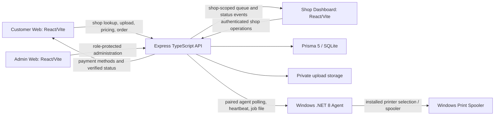

# PrintQ reference reconnaissance and implementation audit

**Scope:** read-only reconnaissance of the public reference and the PrintQ source, followed by limited, evidence-based reliability and content changes. No production data, configuration, or services were changed.

## Reference pages discovered

The reference was inspected at the following URLs on 2026-10-30. These are observations of the pages available to the browser/text inspection, not verification of the reference vendor's operational claims.

| URL | Observed content | Status |
| --- | --- | --- |
| `https://qrseprint.in/` | Main landing page, navigation, product choice, setup video, plans, WhatsApp printing, Android product, cyber-cafe tools, reviews, feature/operations sections, privacy claims and footer | Inspected |
| `/features` | Same landing-page shell/content as home, with Feature navigation | Inspected; not a distinct feature detail page |
| `/about` | Same landing-page shell/content as home | Inspected; not a distinct about page |
| `/contact` | Same landing-page shell/content plus contact navigation/content | Inspected |
| `/partner` | Same landing-page shell/content with Partner Program entry | Inspected; distinct agent details are at `/agent` |
| `/disclaimer` | Same landing-page shell/content with Declaration navigation | Inspected |
| `/requirements` | Separate WhatsApp-print product page and demo/plan form | Inspected; form submission was not performed |
| `/agent` | Separate referral/agent program page | Inspected; no account or payout action performed |
| `/whitelabel` | Separate white-label partner page/form | Inspected; form submission was not performed |
| `/international` | Country selection and localized pricing/registration content for named countries | Inspected; no transaction performed |
| `/android` | Redirects to the main landing page | Inspected |

The reference's page shell advertises several separate products (WhatsApp printing, Android printing, offline cyber-cafe software, international plans, referral agents and white-label reselling). They are not assumed to be PrintQ features. The reference also makes claims about deletion, installed printers, payment routing, counts and uptime which were not independently verified and are not copied as factual PrintQ claims.

### Navigation, layout and observed journey

The public shell has desktop navigation for Home, Pricing, How to Setup, Feature, About, Contact, Partner Program, Declaration and Shop Owner Login, plus a mobile navigation variant and promotional banners. The landing page order observed is product/hero, product/device choice, setup video, plans, WhatsApp product, Android product, cyber-cafe product, reviews, broader feature list, privacy/operations content, FAQs and footer. The `/requirements` flow collects shop/contact/plan details and explains WhatsApp pairing and print setup. The accessible content exposes no authenticated shop dashboard or customer transaction; those parts were not exercised.

**Visual evidence and scope:** the reference homepage and its narrow, tablet and desktop layouts were captured during this work using the available controlled browser runtime. Local Customer Web, Shop Dashboard and Admin entry screens were also captured at desktop and mobile widths. The reference is a public marketing/product site; it does not expose an equivalent authenticated shop or super-admin console. Those PrintQ consoles therefore remain purpose-built operational applications, and are not represented as pixel replicas of unrelated reference pages. Screenshot captures are visual review evidence from the session and are not committed as production assets. Exact pixel equality has not been measured.

## PrintQ architecture and workflow map

The repository is an npm-workspaces monorepo (`apps/*`, `packages/*`) with shared `@printqr/config`, `@printqr/types` and `@printqr/validation`. The API has Express routes under `/api`, Prisma/SQLite persistence, uploaded-file storage and Socket.IO. React/Vite applications live at `apps/customer-web`, `apps/shop-dashboard` and `apps/admin-web`. The Windows agent is a .NET 8 WPF application under `apps/print-agent`.

### Main source entry points

| Area | Source evidence |
| --- | --- |
| Customer routes | `apps/customer-web/src/App.tsx`: `/print/:shopSlug`, `/track/:orderNumber`, shop registration and legal routes; tracking token remains in query string |
| QR customer journey | `apps/customer-web/src/pages/CustomerLandingPage.tsx`: shop options, upload/settings, server pricing and idempotent `POST /orders/create` |
| Order tracking/payment | `apps/customer-web/src/pages/OrderTrackingPage.tsx`: token-protected tracking, pending UPI reference and payment-status polling |
| Customer endpoint client | `apps/customer-web/src/lib/api.ts`; API URL selection in `apps/customer-web/src/lib/api-base-url.js` |
| Order API | `apps/api/src/routes/order.routes.ts`: `POST /create`, `GET /track/:orderNumber`, authenticated shop order and job operations |
| Payment API | `apps/api/src/routes/payment.routes.ts`: payment creation/status, manual UPI proof, gateway webhooks and shop gateway settings |
| Shop lookup | `apps/api/src/routes/shop.routes.ts`: public slug lookup and shop-scoped operations |
| College free-print | `apps/api/src/routes/free-print.routes.ts`: public options, user/guest verification, admin and shop operations |
| Agent API | `apps/api/src/routes/agent.routes.ts`: pairing, polling, file download, printer sync, heartbeat and job status |
| Persistence | `apps/api/prisma/schema.prisma`: shops, printers, agents, orders, items, jobs, payments and subscriptions |
| Admin / shop portals | `apps/admin-web` and `apps/shop-dashboard`; both call shared API routes, protected by backend authentication/authorization |
| Windows desktop | `apps/print-agent`; .NET 8 WPF, local printer integration and paired API communications |

### Journey status

| Journey step | Source-level status | Limits / evidence |
| --- | --- | --- |
| Open shop QR route | Implemented | Customer route uses slug and public shop lookup; live shop availability was not tested here |
| Upload documents and set options | Implemented | Existing upload/validation/settings flow is present; real file service not exercised in this audit |
| Get price | Implemented | Server calculation endpoint is used; marketing page no longer substitutes local plan defaults |
| Create order and get tracking values | Implemented | API creates order/jobs transactionally and uses request idempotency; payment initialization happens after the order transaction, so a later initialization error can leave a persisted order for retry/recovery |
| Pay / submit UPI reference | Partially implemented | UPI is direct shop payment and manual verification; customer-submitted references are not proof of payment |
| Shop queue and payment review | Implemented | Shop-authenticated endpoints and payment review paths exist; production account-level flow not replayed |
| Agent pairing and polling | Implemented | Temporary pairing, paired-agent auth, shop-scoped polling/file access and status reports exist |
| Print output | Partially implemented | Windows agent talks to the Windows spooler; source/API status does not establish physical paper output or device feedback |
| Lost agent job recovery | Fixed in this branch | Expired in-flight claim now enters `FAILED`/operator review; never silently requeued because a duplicate physical print cannot be ruled out |
| Receipts/history | Implemented in source | Not independently exercised against production data |

## Feature comparison and page status

| Reference experience | PrintQ counterpart | Status and action |
| --- | --- | --- |
| Main hero and navigation | Customer Web `HomePage` | Kept PrintQ/AnishNova identity; removed simulated operational values and corrected timing/printing claims |
| Plans and pricing | Public plan API + `HomePage` pricing | Now renders only valid active API plans; no hardcoded plan fallback. Empty/error state is explicit with retry |
| Setup video | Public demo-video API | No sample video fallback; section is hidden until active API configuration arrives |
| Testimonials and statistics | Public APIs | Testimonials only appear when returned by API; statistics show unavailable markers instead of invented values |
| Contact and partner forms | Existing lead APIs in `HomePage` | Success only follows an API success response; network/API errors are shown, not replaced with fabricated reference numbers |
| Windows agent download | Agent release metadata endpoint | Version comes from validated API manifest; failed/invalid metadata shows unavailable with retry, no `1.0.0` fallback |
| Customer header navigation | Customer Web `HomePage` | This stage removes duplicate Contact/Partner actions when those destinations already exist in API-configured navigation, keeps them available when omitted, tightens desktop spacing and corrects the repeated “from” in the hero headline |
| WhatsApp print product | No verified equivalent identified in PrintQ source | Not copied or represented as implemented |
| Android print app | No verified Android app in this monorepo | Not copied or represented as implemented |
| Offline cyber-cafe suite | No verified equivalent in this monorepo | Not copied or represented as implemented |
| International localized plans | Existing schema/API not shown to implement the reference country flow | Not copied; needs an explicit product and pricing decision |
| Referral / white-label pages | PrintQ has partner-related code but not verified parity with reference mechanics | Existing PrintQ partner flow retained; no external payout or white-label capability invented |
| Feature detail / about / declaration | PrintQ's landing sections and legal routes | No pixel-level page parity verified; separate reference URLs mostly return the same shell, while reference product claims are not adopted without source evidence |

Screenshots confirm the broad responsive hierarchy, but exact geometry, font rendering, color values, icon shapes and image positioning have not been measured against the reference. The Customer Web is the closest visual counterpart; the Shop and Admin portals have no matching authenticated reference screens. This code stage addresses the confirmed duplicate-navigation and spacing defect, not a claim of pixel-perfect replication.

## Confirmed findings and prioritized changes

### P0 — reliability / integrity

1. **Agent claims could strand jobs indefinitely.** `AgentController.pollPrintJobs` changed `QUEUED` jobs to `DOWNLOADING`, and stale recovery did not cover `PRINTING` or `SENT_TO_SPOOLER`. A dropped agent could leave in-flight states unreviewed. This branch now finds stale in-flight jobs (15-minute lease, including legacy null `startedAt`) and atomically marks them `FAILED` with an explicit “physical output unknown; inspect before retry” message. It broadcasts job/order state and deliberately does not automatically print again.
2. **Agent status updates renew the lease.** Valid status reports refresh `startedAt`, so active work is not expired solely because the original claim time passed while progress was reported.
3. **Duplicate status callbacks.** The existing service helper accepts idempotent repeated statuses; tests cover the current transition/idempotency policy. A replayed status response does not create a second job.

### P1 — truthful customer-facing behavior

1. **Plans and release version must not be fabricated.** Removed client defaults for plans and `1.0.0`; API plan/release metadata is validated before presentation. Pricing shows an error/retry if unavailable. Agent download requires validated version/hash/size metadata and uses the API's latest installer endpoint.
2. **Demo content and numerical proof points.** The old homepage had fallback testimonials/demo video and fabricated-looking order/price/printer states. Those are now absent until the APIs return real content; illustrative product copy is labeled as such. Statistics are not locally synthesized.
3. **Lead forms falsely succeeded on errors.** Contact/partner submissions used synthetic reference IDs in network failure paths. They now show success only when the API confirms success and display an accessible error otherwise.
4. **Marketing claims exceeded verified workflow.** Home copy now explains server-priced orders, shop-configured payment, manual UPI verification, paired agent dependency and spooler-vs-physical-print distinction. Existing reference offers not implemented by PrintQ are not added.

### P2 — design and product parity backlog

1. Continue screenshot comparisons for reference and PrintQ at mobile, tablet and desktop widths; the next visual pass should focus on measured section widths, hero composition, product cards and footer spacing.
2. Decide whether PrintQ should build separate WhatsApp, Android, offline cyber-cafe, international pricing, referral payout or white-label products. The current code does not provide verified parity for these and they require product/security/payment decisions.
3. Test complete flows with a sandbox shop/account and a Windows host. Run physical test jobs only through an explicitly authorized test order and printer.

## Test and verification record

Automated checks run on this branch:

- Customer Web tests: 13 passed.
- API tests: 56 passed.
- Shop Dashboard tests: 11 passed.
- Admin Web tests: 10 passed.
- API, Customer Web, Shop Dashboard and Admin Web type checks: passed individually.
- Production builds for API, Customer Web, Shop Dashboard and Admin Web: passed individually.
- Prisma schema validation: passed.
- Windows x64 Agent 1.0.3 publish and release verification: passed locally.
- `git diff --check`: passed (Git reports only line-ending normalization warnings for the existing README and the changed test file).
- Root `npm run type-check` and root `npm run build`: blocked at `prisma generate` by Windows `EPERM` renaming the SQLite query-engine DLL in the shared `node_modules/.prisma/client` path. The shared package builds preceding this step passed. The API compiler/build passed using the already generated client. Existing running Node processes were left undisturbed.

Not verified in this environment: exact pixel measurements, production shop/order/payment behavior, authenticated shop/admin sessions, Windows multi-printer discovery, actual printer output, Vercel deployment and live API data. No live payment, production order or deployment was initiated.
